# FM1 Studio

Run FM-1 firmwares **SLOOP, FM1 MOVE, Felucca, sloopDX, Ghoulbox and zp12** on Android, with
native firmware displays, touch controls, a piano roll, sound editors.

## Credits

The synthesis engines, sequencing and native interfaces are the work of the
original firmware creators and their contributors:

- **[Felucca](https://github.com/hugelton/Felucca)** — **Leo Kuroshita (@kurogedelic), Hügelton Instruments**, the foundation of this firmware family.
- **[SLOOP](https://github.com/isod89/sloop-fm1)** — **isod89 and contributors**, building on Felucca.
- **[FM1 MOVE](https://github.com/Nicodesy06/FM1-MOVE)** — **Nicodesy06 and contributors**, building on SLOOP/Felucca.
- **[sloopDX](https://github.com/zvenson/dxsloop)** — **Sven Trogus**, building on SLOOP/Felucca, with the Dexed msfa core by **Google and Pascal Gauthier**.
- **[Ghoulbox](https://github.com/jasonpersinger/ghoulbox-fm1-dungeon-synth)** — **Jason Persinger**, building on Felucca by Leo Kuroshita / Hügelton Instruments, with dungeon synthesis, hurdy-gurdy, cathedral reverb and a native dungeon interface.
- **[zp12](https://github.com/zvenson/zp12)** — **Sven Trogus (@zvenson) and contributors**, a 12-bit sampling drum machine using the SLOOP/Felucca platform and sloopDX effects.
- **[FM-1-RE](https://github.com/AL-255/FM-1-RE)** — **AL-255 and contributors**, whose M-VAVE FM-1 reverse-engineering research helped make independent firmware possible.
- **[Dinghy](https://github.com/zvenson/dinghy)** — **Sven Trogus and contributors**, documenting the hardware/firmware plumbing.

FM1 Studio adds the Android host, adapters and touch editing workflow.
Upstream sources and notices are preserved. See [credits and licenses](LICENSING.md)
for DSP, font, sample and platform dependencies. This project is independent of
M-VAVE and the upstream firmware authors; no endorsement is implied.

## Screenshots

<table>
  <tr>
    <td align="center"><a href="docs/screenshots/01-sloop-native.png">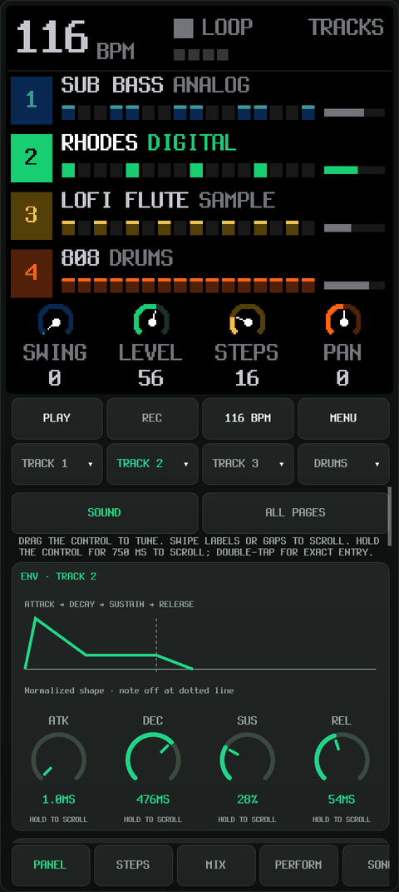</a><br /><sub>Native display</sub></td>
    <td align="center"><a href="docs/screenshots/02-sound-editor.png">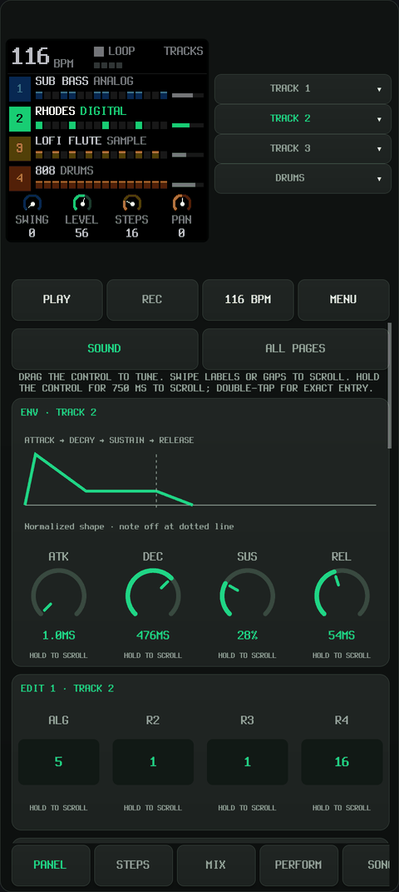</a><br /><sub>Sound editor</sub></td>
    <td align="center"><a href="docs/screenshots/03-piano-roll.png">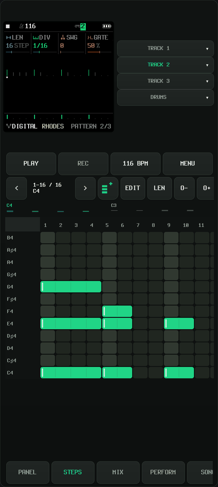</a><br /><sub>Piano roll</sub></td>
    <td align="center"><a href="docs/screenshots/04-chord-editor.png">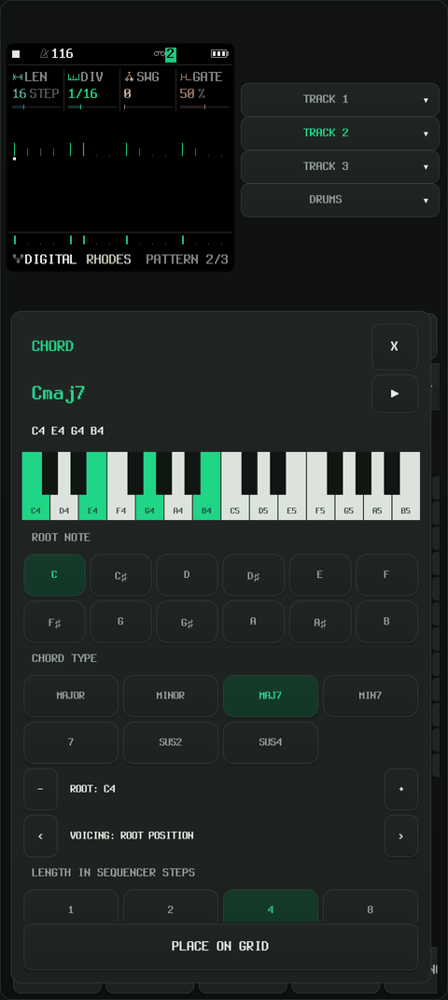</a><br /><sub>Chord editor</sub></td>
  </tr>
  <tr>
    <td align="center"><a href="docs/screenshots/05-drum-grid.png">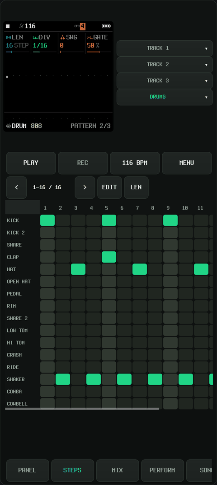</a><br /><sub>Drum sequencer</sub></td>
    <td align="center"><a href="docs/screenshots/06-drum-sound.png">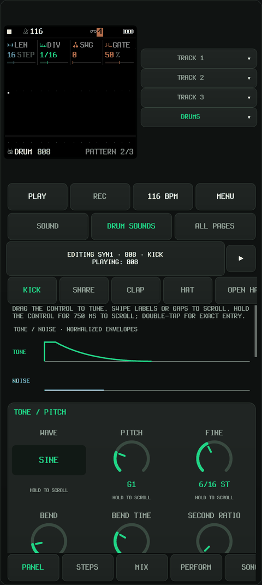</a><br /><sub>Drum sound editor</sub></td>
    <td align="center"><a href="docs/screenshots/07-mixer.png">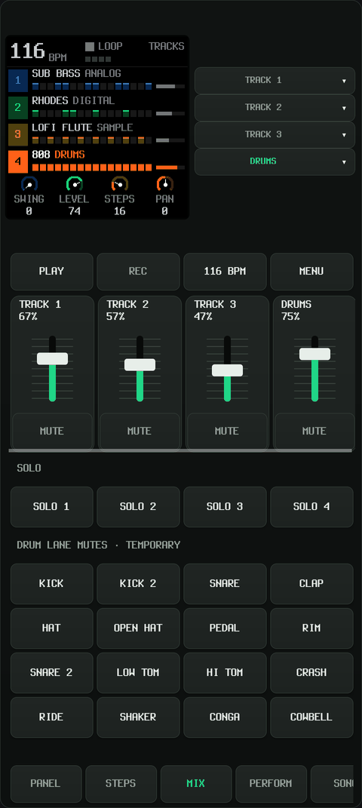</a><br /><sub>Mixer</sub></td>
    <td align="center"><a href="docs/screenshots/08-performance.png">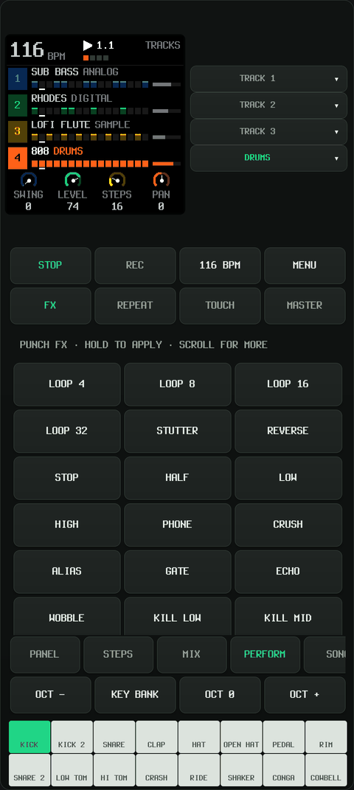</a><br /><sub>Performance pads</sub></td>
  </tr>
</table>

<a href="docs/screenshots/09-landscape.png">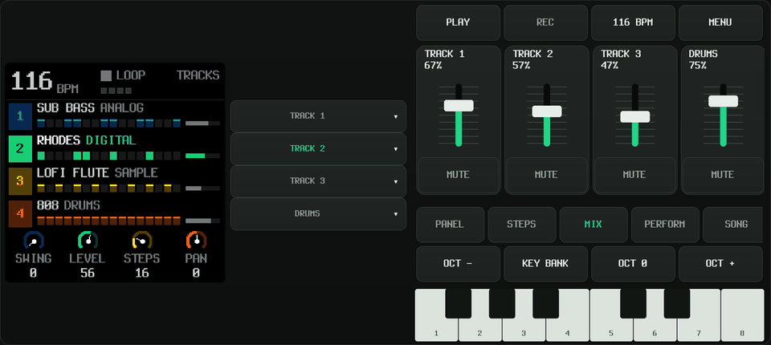</a>

| SLOOP | FM1 MOVE | Felucca | sloopDX |
| --- | --- | --- | --- |
| <a href="docs/screenshots/10-firmware-sloop.png">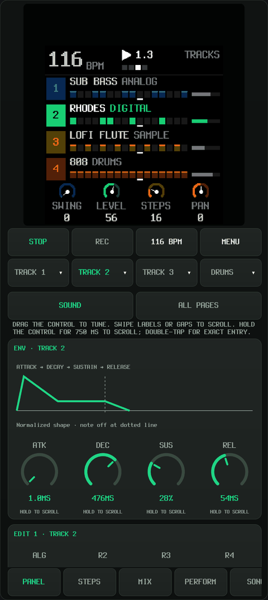</a> | <a href="docs/screenshots/11-firmware-move.png">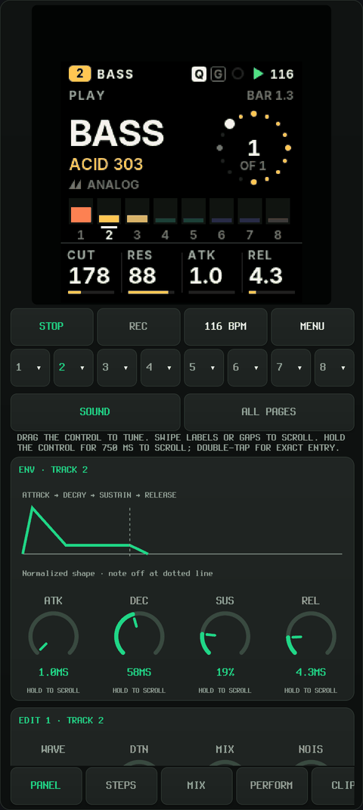</a> | <a href="docs/screenshots/12-firmware-felucca.png">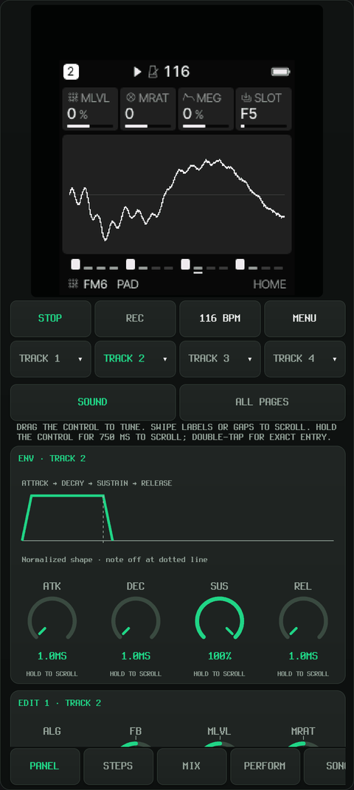</a> | <a href="docs/screenshots/13-firmware-sloopdx.png">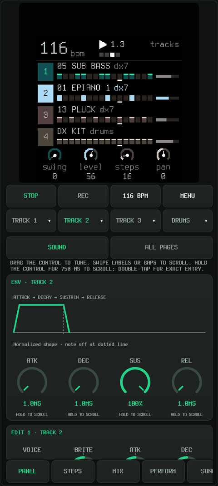</a> |


| Ghoulbox | zp12 |
| --- | --- |
| <a href="docs/screenshots/14-firmware-ghoulbox.png">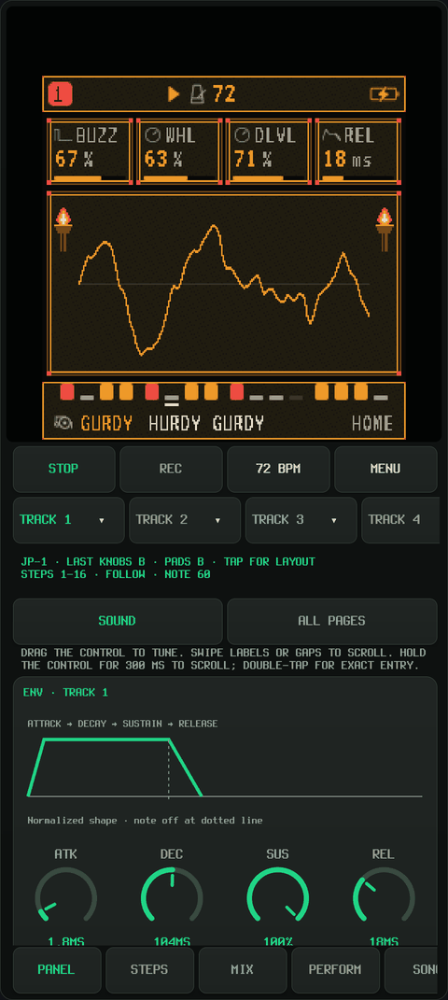</a> | <a href="docs/screenshots/15-firmware-zp12.png">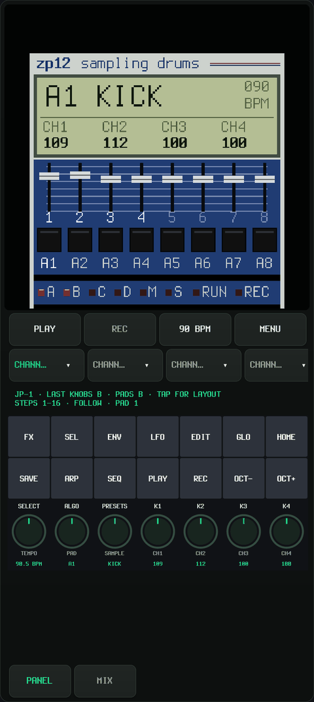</a> |

## Build

Python 3.10+ is required. Both build scripts print OS-specific installation
commands and check dependencies before starting; they do not install OS or
Python packages automatically.

```sh
git submodule update --init --recursive
python3 android/build.py --setup
# Run the printed setup commands, then:
python3 android/build.py --check-deps
python3 android/build.py
```

Android needs Pillow/fontTools/NumPy, JDK 17 or 21, SDK platform 35, build-tools 35.0.0
and NDK 27.2.12479018. The setup commands use JDK 21. Set `JAVA_HOME` and
`ANDROID_SDK_ROOT` for custom installations. All six firmware sources are pinned
submodules under `fw-ext`; `SLOOP_SOURCE`, `MOVE_SOURCE`, `FELUCCA_SOURCE`,
`SLOOPDX_SOURCE`, `GHOULBOX_SOURCE` and `ZP12_SOURCE` override them. Generated files stay under `build/`.

```sh
adb install -r build/android/fm1-studio.apk
python3 android/build.py --release        # signed release, debugging disabled
python3 android/build.py --firmwares sloop  # optional single-engine build
python3 android/build.py --abi x86_64      # optional emulator build
python3 tests/run.py
```

The Android package is `org.fm1.studio`.

The **ESP32-P4 port is internal and unfinished**. Its implementation notes are
kept in the [internal port documentation](esp32p4/README.md).

## Play and learn

Choose an engine in **Menu → Instrument Settings → Firmware**. Each engine keeps
its own projects and settings. Switching firmware loads the selected engine library.
**Ghoulbox** includes its curated sounds, dungeon display and Felucca-style touch
editors. **zp12** opens its native **PANEL**: use the function buttons and encoders
with the full keyboard for pads, loop selection, recording, sound editing and
song mode; **MIX** controls its eight output channels. SELECT, ALGO, PRESETS and
K1–K4 are rotary encoders: drag their circular dials horizontally or vertically.
The labels and values below K1–K4 follow the native page. zp12 supports MIDI notes
36–67 and Program Change 0–15, plus independent saves and Android backup/restore.
Its native step editor is available through SEQ; the shared piano roll, FSMP/WAV
import and device web-editor USB link are not exposed by this adapter.

Use **PANEL → SOUND** for instrument controls, **DRUM SOUNDS** for individual
SLOOP/MOVE drum voices, and **STEPS** for notes and one-shot chord placement.

- [Tutorials, with original creators credited](tutorials/README.md)
- [Control reference](tutorials/CONTROLS.md)
- [Controls, firmware definitions and implementation](docs/DEVELOPMENT.md)
- [Internal, unfinished ESP32-P4 port](esp32p4/README.md)

## External MIDI controllers

FM1 Studio accepts MIDI inputs exposed by Android over USB/OTG or Bluetooth LE
MIDI. Keyboards sending standard MIDI can play notes with velocity without
learning each key. In **Menu → MIDI /
AUDIO / FILES**, connect the device, then choose **MIDI routing and pad notes →
Selected track** for a simple keyboard setup. Use the app's recording controls to
record your playing into the pattern and view it in **STEPS**; the controller
does not directly operate the piano-roll editor. Compatibility depends on the
device's MIDI connection and messages; a dedicated controller profile is not
required for basic note input.

Knobs can use the firmware's standard CC assignments, **MIDI knobs → FM-1** for
seven consecutive CCs, or parameter MIDI learn in SLOOP and Felucca. Drum pads can
use the firmware's drum notes or a manually configured consecutive note range.
Generic buttons are usable only when their messages match actions supported by
the selected firmware: there is currently no general button/action learning or
per-key note remapping. **JP-1 controller mapping** is specific to the JP-1 and
does not enable learning for other controllers. See the short [external MIDI setup
guide](docs/MIDI-CONTROLLERS.md) for connection, recording and mapping steps.

## License

Project code is **GPL-3.0-only** ([LICENSE](LICENSE)); third-party components and
assets retain their own terms. See [credits and licenses](LICENSING.md) for
component authors and applicable code, font and asset terms.
Binary releases must include applicable notices and complete corresponding source.
